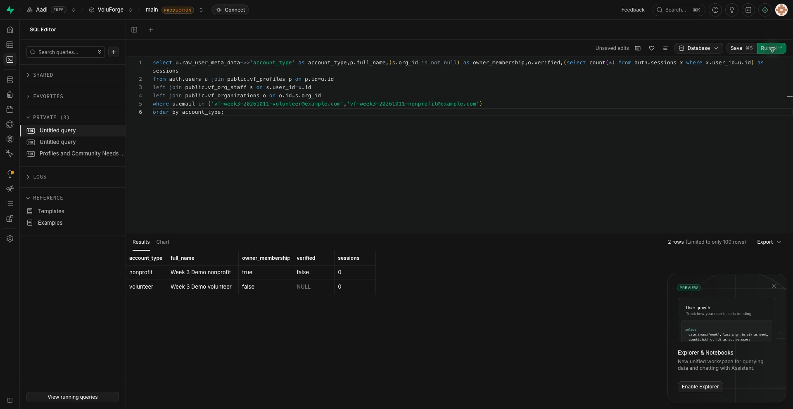
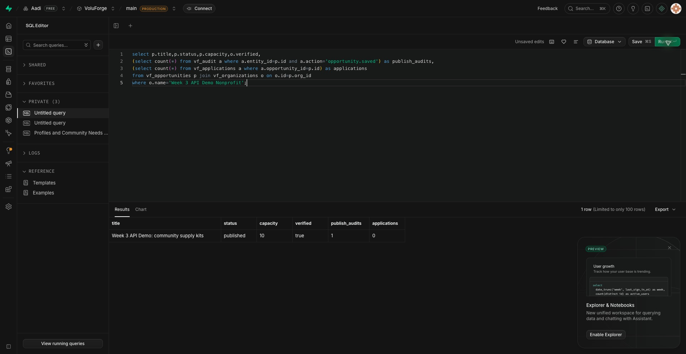
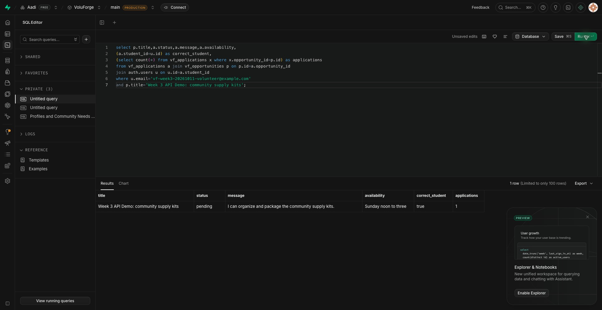
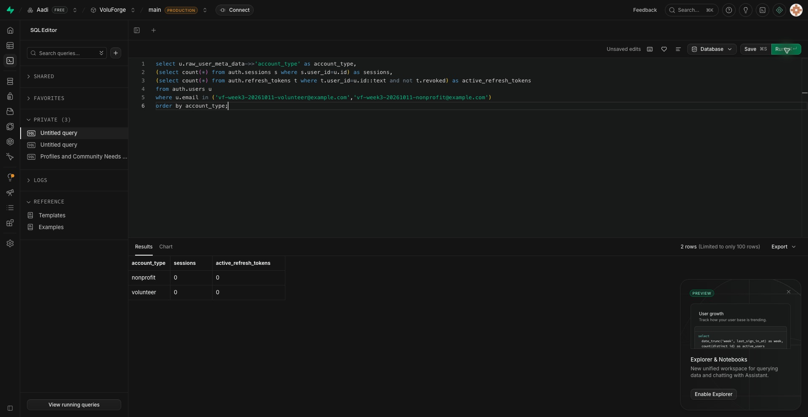

# Week 3 — live API and database evidence

Verified October 11, 2026. The HTTP server ran locally at `http://127.0.0.1:3157`; it called **real hosted Supabase Auth/PostgreSQL**, not mocked responses. SQL was queried independently in the signed-in Supabase SQL Editor, before and after each state-changing phase. Secrets were loaded from ignored `.env.local`/private test state and were never printed or committed.

## Required API coverage

| Assignment requirement | Committed implementation | Live result / independent SQL |
| --- | --- | --- |
| Volunteer creates account | `POST /api/v1/auth/signup` | 201; 0 → 2 total synthetic Auth accounts; volunteer profile exists |
| Nonprofit creates account | Same route, `accountType: nonprofit` | 201; nonprofit profile, unverified organization and owner membership exist |
| Both roles login | `POST /api/v1/auth/login` | 200 each; each session count 0 → 1; identity route returns correct user |
| Nonprofit creates opportunity | `POST /api/v1/opportunities` | Unverified denied 403; operator-verified fixture succeeds 201; SQL shows published row and 1 audit event |
| Volunteer lists opportunities | `GET /api/v1/opportunities` | 200; response includes the exact nonprofit-created opportunity |
| Volunteer applies | `POST /api/v1/opportunities/{id}/applications` | 201; SQL application count 0 → 1; pending status, message, availability and student match |
| Nonprofit views applications | `GET /api/v1/applications?opportunity_id={id}` | Owner 200 with exact application ID; volunteer denied 403 |
| Both roles logout | `POST /api/v1/auth/logout` | 200 each; session counts 1 → 0; active refresh tokens 0; refresh requests rejected 400 |

Source: [API route](../../../app/api/v1/[...path]/route.ts), [implementation](../../../lib/api/volunteer.ts), [signup migration](../../../database/migrations/202610070001_api_nonprofit_signup.sql), [API documentation](../../api-layer.md).

## Screenshots

These are captured SQL Editor screenshots of actual query results, not generated illustrations.

| Screenshot | What it proves |
| --- | --- |
| [01 — before signup](01-before-signup.png) | Test account/organization counts were zero; signup migration had not yet been applied |
| [02 — after signup](02-after-signup.png) | Both profiles, owner membership, verification=false, zero sessions before login |
| [03 — after login](03-after-login.png) | One session for each role; zero opportunities after denied publication attempts |
| [04 — publication / before apply](04-published-before-apply.png) | Published opportunity, capacity 10, verification=true, one audit, zero applications |
| [05 — after apply](05-after-apply.png) | Correct pending application and exactly one row after duplicate/self-application attempts |
| [06 — after logout](06-after-logout.png) | Both users have zero sessions and zero active refresh tokens |
| [07 — fixture closed](07-fixture-closed.png) | Synthetic listing closed and organization unverified after testing |

## Reproduce and inspect

[Sanitized HTTP assertions](http-results.json) record 32 passing checks (including duplicate attempts). [Exact SQL sections](verify.sql) reproduce the direct database checks. [Phased Python HTTP runner](../../../tests/api-live/controlled-demo.py) loads its generated passwords/tokens from an ignored mode-0600 state file. Use the dedicated-database [automated HTTP+SQL runner](../../../tests/api-live/run.py) when DATABASE_URL is available.

Verification ran in dependency order: schema preflight → signup migration → both signups → SQL profiles/membership → confirm only synthetic emails → both logins → SQL sessions → denied unverified/volunteer publishing → operator-verify only synthetic nonprofit → publish/list → SQL opportunity/audit → apply/review/duplicates → SQL application → logout/refresh denial → SQL sessions → close/unverify fixture.

Additional checks: invalid credentials 401, anonymous access 401, invalid pagination/capacity 400, self-application 403, duplicate 409, unknown route 404, wrong method 405, cross-origin mutation 403, admin signup 400, non-object JSON 400. The initial self-application expectation was corrected from 409 to the API's permission status 403; subsequent check passed and SQL confirms no extra row.

Local validation: production Next.js build and TypeScript passed; `node database/tests/api-workflow.mjs` passed; `node database/tests/validate.mjs` passed 50 workflow/security checks plus opportunity details and ten RLS tables. The checked-in shared website source manifest also verified.

Limitations: confirmation was set only for the two fictional test emails; real email delivery/recovery is pending. Logout revokes refresh sessions, while copied JWTs may remain valid until expiry. No production website deployment or full semester service/export acceptance is claimed. The synthetic listing is closed/unverified and creates no verified service credit; its rows remain available for inspection.
