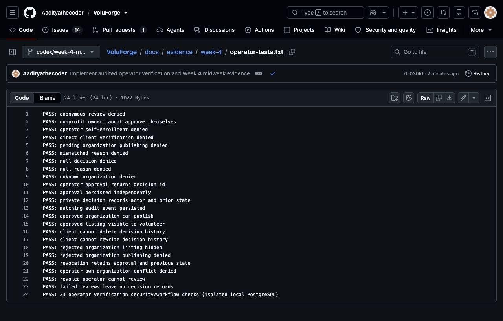

# Week 4 mid-week evidence — October 14, 2026

- [Operator verification output](operator-tests.txt): 23 isolated PostgreSQL security/workflow checks, all pass.
- [Regression output](regression-tests.txt): existing 50 workflow/security checks, opportunity details and shared/mobile migration parity pass.
- [Implementation and deployment runbook](../../operator-verification.md).

These are local checks, not hosted or browser acceptance. No real organization verification, deployment, email delivery or focused-hour total is claimed. Tests create synthetic in-memory fixtures that disappear on database close.

## Screenshot of committed test results

Captured from the committed GitHub test-output page; this is evidence of local test results, not a hosted product screenshot.
